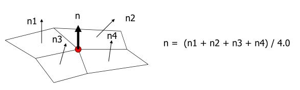
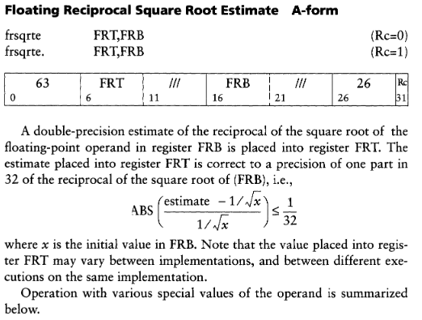
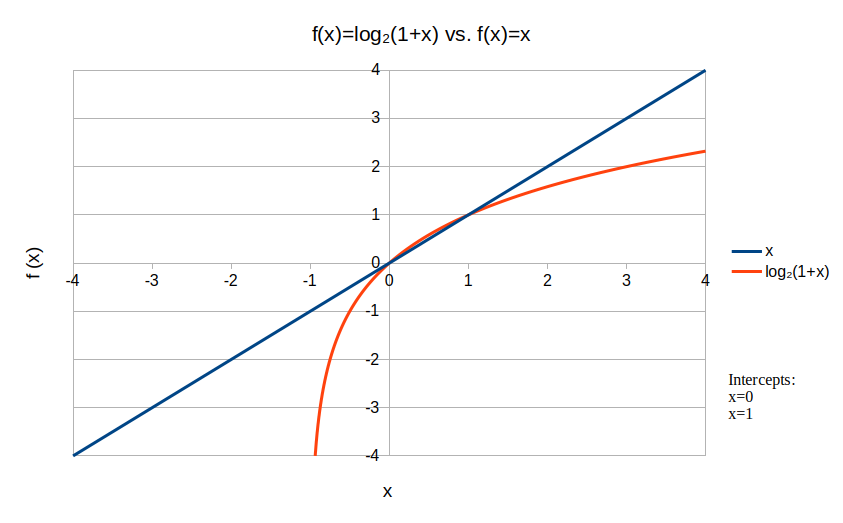
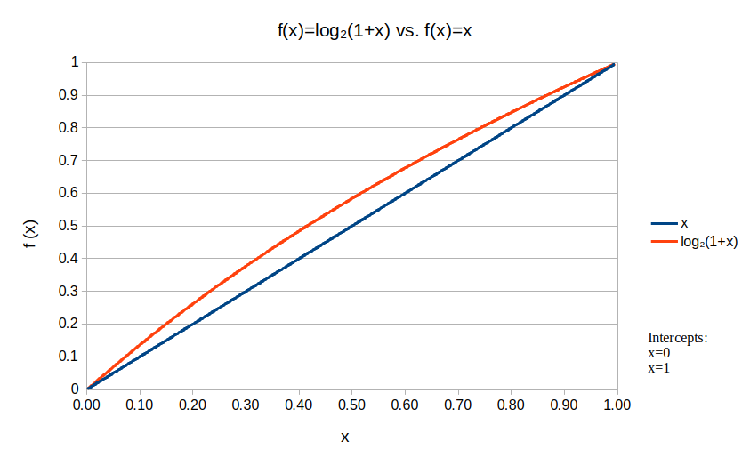
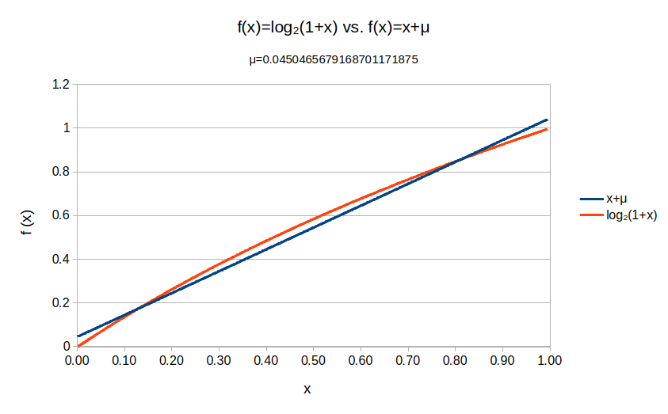

<H1>Analysis of the Quake-III-Arena Fast Inverse Square Root</H1>
<H2>Overview</H2>

The famous quake3 algorithm is an approximation of the inverse square root of a number x (where x is a positive real number). 

$$f(x) = {1 \over \sqrt{x}}$$
$$\\{x \in \mathbb{R} \mid x > 0\\}$$

<H2>Key Concepts</H2>
  <ol>
    <li>Normalized numbers in IEEE 754.</li>
    <li>Piecewise linear approximation.</li>
    <li>Bit manipulation in the C-language.</li>
    <li>Take advantage of constraints (input will always be positive and the result will always be between 0 and 1).</li>
  </ol>

<H2>Computer Graphics Background</H2>

The algorithm's primary purpose is to optimize vector normalization in a computer graphics and rendering context. Inverse square roots are used to normalize a vector, usually a surface normal of a polygon or light ray. These normals are then used (depending on the shading model) to calculate the reflection of a light source on an object. The common shading models that existed both during game development and still used today are flat shading, Gouraud shading and Phong shading. In Quake III Arena, the graphics engine primarily uses Gouraud shading. 

The Gouraud shading model uses the surface normals of each surrounding polygon (face normals) to interpolate the surface normal at the vertex. Once the vertex normal is known, it is possible to compute the diffuse and specular light components of the Gouraud model.

  
   
  <figcaption>
    Gouraud Surface Normal Interpolation <a href="#references">[5]</a>
  </figcaption>

 

For the specular light component, we need to first know the reflected light ray. The equation to calculate the reflected light ray is the following:

$$R = 2(\hat{N}\cdot\hat{L})\hat{N}-\hat{L} $$

This calculation requires both the surface normal at the vertex and the normalized light vector. The specular light component still requires one more calculation after finding the reflected light. However, I only want to highlight the normalized vectors here. These calculations for specular light are seen in the quake3 graphics engine code:

<pre>
<code>
Source: https://github.com/id-Software/Quake-III-Arena/blob/master/code/renderer/tr_shade_calc.c#L1040

void RB_CalcSpecularAlpha( unsigned char *alphas ) {
	int			i;
	float		*v, *normal;
	vec3_t		viewer,  reflected;
	float		l, d;
	int			b;
	vec3_t		lightDir;
	int			numVertexes;

	v = tess.xyz[0];
	normal = tess.normal[0];

	alphas += 3;

	numVertexes = tess.numVertexes;
	for (i = 0 ; i < numVertexes ; i++, v += 4, normal += 4, alphas += 4) {
		float ilength;

		VectorSubtract( lightOrigin, v, lightDir );
//		ilength = Q_rsqrt( DotProduct( lightDir, lightDir ) );
		VectorNormalizeFast( lightDir );

		// calculate the specular color
		d = DotProduct (normal, lightDir);
//		d *= ilength;

		// we don't optimize for the d < 0 case since this tends to
		// cause visual artifacts such as faceted "snapping"
		reflected[0] = normal[0]*2*d - lightDir[0];
		reflected[1] = normal[1]*2*d - lightDir[1];
		reflected[2] = normal[2]*2*d - lightDir[2];

		VectorSubtract (backEnd.or.viewOrigin, v, viewer);
		ilength = Q_rsqrt( DotProduct( viewer, viewer ) );
		l = DotProduct (reflected, viewer);
		l *= ilength;

		if (l < 0) {
			b = 0;
		} else {
			l = l*l;
			l = l*l;
			b = l * 255;
			if (b > 255) {
				b = 255;
			}
		}

		*alphas = b;
	}
}
</code>
</pre>

It is important to understand the shading model used in the graphics engine because it helps us understand the complexity underneath just one vertex lighting calculation and why the developers sought to optimize it. For just one vertex, we might have to calculate 3 to 4 face normals and a light normal. Every time a vector is normalized, a square root operation is used. Pure software square root operations cost more cycles at the hardware level than an operation such as addition or multiplication. Lets look at where the square root comes from during vector normalization. To normalize a 3D vector to 1, the components of the vector must be scaled by the magnitude (length) of the total vector.

$$ \text{Magnitude (length) of 3D vector} = \sqrt{x^2 + y^2 + z^2}$$

Now lets scale each component x, y & z :

$$ \text{Normalized vector coordinates} = ({x \over \sqrt{x^2 + y^2 + z^2} }), ({y \over \sqrt{x^2 + y^2 + z^2} }), ({z \over \sqrt{x^2 + y^2 + z^2} })$$

You can also re-write this to be:

$$ \text{Normalized vector coordinates} = ({1 \over \sqrt{x^2 + y^2 + z^2}} *x), ({1 \over \sqrt{x^2 + y^2 + z^2} } * y), ({1 \over \sqrt{x^2 + y^2 + z^2} } * z)$$

Now you can see that we have term that matches:

$${1 \over \sqrt{something}}$$

This is  the inverse square root term that the developers of quake3 sought to optimize. Speeding up this operation would significantly improve performance in the graphics engine because of how often the square root gets used per vertex. Also consider how many vertex calculations are computed per frame -- probably thousands, if not hundreds of thousands or even millions.

There is also one important fact that I rarely see discussed when covering this algorithm; the developers also took advantage of hardware optimized instructions for square roots when available. There already existed specific assembly instructions for fast square roots. Let's take a look at the code below:

<pre>
<code>
Source: https://github.com/id-Software/Quake-III-Arena/blob/master/code/renderer/tr_surface.c#L555

static void VectorArrayNormalize(vec4_t *normals, unsigned int count)
{
//    assert(count);
        
#if idppc
    {
        register float half = 0.5;
        register float one  = 1.0;
        float *components = (float *)normals;
        
        // Vanilla PPC code, but since PPC has a reciprocal square root estimate instruction,
        // runs *much* faster than calling sqrt().  We'll use a single Newton-Raphson
        // refinement step to get a little more precision.  This seems to yeild results
        // that are correct to 3 decimal places and usually correct to at least 4 (sometimes 5).
        // (That is, for the given input range of about 0.6 to 2.0).
        do {
            float x, y, z;
            float B, y0, y1;
            
            x = components[0];
            y = components[1];
            z = components[2];
            components += 4;
            B = x*x + y*y + z*z;

#ifdef __GNUC__            
            asm("frsqrte %0,%1" : "=f" (y0) : "f" (B));
#else
			y0 = __frsqrte(B);
#endif
            y1 = y0 + half*y0*(one - B*y0*y0);

            x = x * y1;
            y = y * y1;
            components[-4] = x;
            z = z * y1;
            components[-3] = y;
            components[-2] = z;
        } while(count--);
    }
#else // No assembly version for this architecture, or C_ONLY defined
	// given the input, it's safe to call VectorNormalizeFast
    while (count--) {
        VectorNormalizeFast(normals[0]);
        normals++;
    }
#endif

}
</code>
</pre>

PPC refers to "PowerPC" which is a RISC architecture developed together by Apple, IBM, and Motorola. It was first released in 1992 and the 2nd edition to the architecture was released in May of 1994. The architecture was used in Apple desktops and later on in gaming consoles in the early 2000's. The architecture has an instruction called "Floating Reciprocal Square Root Estimate" or frsqrte. The estimate has a relative error no greater than 1/32. While this is rather poor precision, it is much faster than traditional instructions used in a reciprocal square root calculation.

  
   
  <figcaption>
    Floating Reciprocal Square Root Estimate <a href="#references">[6]</a>
  </figcaption>

 

The frsqrte instruction is used in combination with one Newton-Raphson iteration to improve accuracy. As we will discuss later on, quake3's fast inverse square root also uses one Newton-Raphson iteration. I do not believe the practice of using Newton-Raphson iterations with reciprocal square roots originated with quake3, and it was possibly recommended from someone else. However, I am still researching when these two methods were first used together.

In summary, the graphics engine will be compiled with hardware optimized frsqrte instructions when defined, otherwise, the software fast inverse square root will be used. Both methods will be finalized with a single Newton-Raphson to improve the accuracy of the estimate.

<H2>IEEE-754</H2>
  
A single precision float in IEEE-754 (also called binary32) is defined in the table below:
  

<!--  -->
<table class="custom-table">
  <tr>
    <td></td>
    <td style="border-left: 1px solid;">Sign Bit (1-bit)</td>
    <td colspan="8"style="text-align:center;
                          border-left: 1px solid;">
        Exponent (8-bit)  
    </td>
    <td colspan="23" style="text-align:center;
                            border-left: 1px solid;
                            border-right: 1px solid;
                            ">
        Mantissa (23-bit)</td>
  </tr>
  <tr>
    <td>Bit Position</td>
    <td>31 (MSB)</td>
    <td>30</td>
    <td>29</td>
    <td>28</td>
    <td>27</td>
    <td>26</td>
    <td>25</td>
    <td>24</td>
    <td>23</td>
    <td>22</td>
    <td>21</td>
    <td>20</td>
    <td>19</td>
    <td>18</td>
    <td>17</td>
    <td>16</td>
    <td>15</td>
    <td>14</td>
    <td>13</td>
    <td>12</td>
    <td>11</td>
    <td>10</td>
    <td>9</td>
    <td>8</td>
    <td>7</td>
    <td>6</td>
    <td>5</td>
    <td>4</td>
    <td>3</td>
    <td>2</td>
    <td>1</td>
    <td>0 (LSB)</td>
  </tr>
  <tr>
    <td>Decimal Range</td>
    <td style="text-align:center; border-left: 1px solid;"> 0 to 1 (1-bit)</td>
    <td colspan="8" style="text-align:center; border-left: 1px solid;">
        0 to 255 (8-bit unsigned number)  
        [255 reserved for -infinity, infinity, NaN]
    </td>
    <td colspan="23" style="text-align:center; border-left: 1px solid; border-right: 1px solid;">
        0 to 8388607 (23-bit unsigned number)
    </td>
  </tr>
</table>

<H4>How to interpret a single precision float (32-bit) in IEEE-754:</H4>
  
The value stored in the 32-bit memory does not represent the final decimal float. The sign, exponent and mantissa stored must be interpreted as the standard defines. The equation is as follows:  

  $$float_{10}= (-1)^{Sign} * (1 + {Mantissa\over 2^{23} } ) * 2^{Exponent-Bias}$$
  

  
When a decimal number is converted to a IEEE-754 float, the value is first converted to binary and then normalized to a value between 1 and less than 2. It does this by bit-shifting the binary value until the MSSB (Most Significant Set Bit, aka the first '1') is to the left of the decimal place (e.g. 1.rest_of_data). The IEEE-754 standard normalizes numbers into this range and implies a leading bit of 1. This only applies for the "Normalized Numbers" part of the standard. This allows an extra bit to be saved for data by dropping the MSSB since it is guaranteed to always be 1.
  

  
The bit-shift is recorded as the initial value for the exponent. Decimal values less than 1 are bit-shifted right, values greater than or equal to 2 are bit-shifted left, and values in-between are already normalized. Shifts to the left are recorded as positive exponents and shifts the right are recorded as negative exponents. No shift is recorded as 0. After dropping the implicit 1 in the number, the Mantissa is left with only the fractional part.

<H4>Offset Binary Notation in IEEE-754:</H4>
  
As previously stated, the initial exponent value is determined from the MSSB bit-shift. However, the exponent is interpreted differently than it is stored. The standard uses a "bias" to interpret the stored exponent value. The bias essentially makes the value signed without using an additional sign-bit. This splits the range of possible values into negative and positive numbers because we need negative and positive exponents to represent out MSSB bit-shift. So for a 32-bit float, the 8-bit exponent has it's decimal range shifted from (0 to 255) to (-126 to 127). This offset is also referred to as "excess-127". Remember that the offset changes depending on the size of the float and therefore the number of bits available to the exponent. For example, a 64-bit float would use excess-1023. This is the equation to find the bias:
  

  $$ bias = 2^{bits-1}-1$$

  
where <i>bits</i> is the available number of bits to the exponent

  
Now let's take a look at the range of possible values for an exponent. We start with an unsigned range represented by:

  $$ \\{0,\space 2^{bits}-1\\} $$

  For an 8-bit exponent, this would mean 256 values (0, 255). 

  
Moreover, the standard reserves the lowest and highest value for special cases (0, -inf, +inf, NaN). This affects the range of the possible unsigned integers to go from (0, 255) to (1, 254). We can represent the decimal range of possible integers as follows.

  $$ \\{1,\space 2^{bits}-2\\} $$
  Next subtract the bias to the lower and upper bounds:
  $$ \\{1-bias,\space (2^{bits}-2) - bias\\} $$
  The upper bound can be simplified further:

  $$
  \begin{aligned}
  (2^{bits}-2) - bias &= (2^{bits}-2) - (2^{bits-1}-1) \\
  &= 2^{bits}-2 - 2^{bits-1}+1 \\
  &= 2^{bits} - 2^{bits-1}-1 \\
  \rightarrow& Apply\space exponent\space rule: x^{m+n}=x^{m}*x^{n} \\
  &= 2^{1}*(2^{bits-1}) - 2^{bits-1} - 1 \space \\
  &= (2-1)*2^{bits-1} - 1 \\
  &= 2^{bits-1} - 1 \\
  &= bias \\
  \end{aligned}
  $$

  So the total range of an exponent in IEEE-754 can be expressed as:
  $$ \boxed{ \\{1-bias,\space bias\\} }$$

  For an 8-bit exponent, the usable range (excluding reserved values) would be (-126, 127). It is important to recall the value stored in the float is still unsigned (0,255), but the interpreted range allows for negative values.

  The standard was designed with this bias for a few reasons:
  

  <ol type="1">
    <li>"If you use exponents to show both integer (n >= 0) and fractional (n < 0) values you have the problem that you need one exponent for 2^0 = 1. So the remaining range is odd, giving you either the choice of choosing the bigger range for fractions or for integers. For single precision we have 256 values, 255 without the 0 exponent. Now IEEE754 reserved the highest exponent (255) for special values: +- Infinity and NaNs (Not a Number) to indicate failure. So we are back to even numbers again (254 for both sides, integer and fractional) but with a lower bias."<a href="#references">[2]</a></li>
    <li>"The second reason is gradual underflow. The Standard declares that normally all numbers are normalized, meaning that the exponent indicates the position of the first bit. To increase the number of bits the first bit is normally not set but assumed (hidden bit): The first bit after the exponent bit is the second bit of the number, the first is always a binary 1. If you enforce normalization you encounter the problem that you cannot encode zero and even if you encode zero as special value, the numerical accuracy is hampered. +-Infinity (the highest exponent) makes it clear that something is wrong, but underflow to zero for too small numbers is perfectly normal and therefore easily to overlook as a possible problem. So Kahan, the designer of the standard, decided that denormalized numbers or subnormals should be introduced and they should include 1/MAX_FLOAT."<a href="#references">[2]</a></li>
    <li> To allow faster comparisons between floats. The exponent must allow for negative and positive values. However, adding a sign bit using two's compliment representation would make comparisons slower because you need to consider the sign bit and potentially perform a subtraction operation to compare order. A sign bit would also reduce the range of possible exponent values. With an offset binary, your lowest value starts at zero and increases normally in binary, so binary comparisons are fast and lexicographical.<a href="#references">[3]</a> Additionally, when comparing equality of two floats, the exponent will be checked before the mantissa. This means you can save time checking equality if the exponents do not match.</li>
    <li> Why not add another sign bit that is separate like the mantissa? I believe this is because you would lose another bit of accuracy in the mantissa, which is prioritized over the exponent range.</li>
  </ol>

<H4>Why it matters?</H4>
  
While it is not necessary to understand the entire IEEE-754 standard for this algorithm, it is necessary to understand the bit representation to help us understand the mathematical approximations in the <a href="#math_approx">next section</a>. Specifically, the bit representations of the mantissa and exponent. Next we will look at how we go from: 

  $$ bit \space representation_{10} = (1 + {Mantissa\over 2^{23} } ) * 2^{Exponent-Bias} $$

  to:

  $$ log_{2}(bit\space representation_{10}) \approx {(M + 2^{23}*E)} $$

  <table>
    <tr>
      <td>31</td>
      <td style="color: red;">30</td>
      <td style="color: red;">29</td>
      <td style="color: red;">28</td>
      <td style="color: red;">27</td>
      <td style="color: red;">26</td>
      <td style="color: red;">25</td>
      <td style="color: red;">24</td>
      <td style="color: red;">23</td>
      <td style="color: teal;">22</td>
      <td style="color: teal;">21</td>
      <td style="color: teal;">20</td>
      <td style="color: teal;">19</td>
      <td style="color: teal;">18</td>
      <td style="color: teal;">17</td>
      <td style="color: teal;">16</td>
      <td style="color: teal;">15</td>
      <td style="color: teal;">14</td>
      <td style="color: teal;">13</td>
      <td style="color: teal;">12</td>
      <td style="color: teal;">11</td>
      <td style="color: teal;">10</td>
      <td style="color: teal;">9</td>
      <td style="color: teal;">8</td>
      <td style="color: teal;">7</td>
      <td style="color: teal;">6</td>
      <td style="color: teal;">5</td>
      <td style="color: teal;">4</td>
      <td style="color: teal;">3</td>
      <td style="color: teal;">2</td>
      <td style="color: teal;">1</td>
      <td style="color: teal;">0</td>
    </tr>
    <tr>
      <td></td>
      <td colspan="8" style="color: red;">2^23 * E (E is bit-shifted by 23) </td>
      <td colspan="23" style="color: teal; text-align: center;">M</td>
    </tr>
    <tr>
    </tr>
  </table>

<H2 id="math_approx">The Mathematical Approximation</H2>
  
The most impressive part of this algorithm is the mathematical intuition behind it. There are two major intuitions. One is a piecewise linear approximation shown below.

  $$ log_{2}(1 + x) \approx x $$
  $$\\{x \in \mathbb{R} \mid 0 \leq x \leq 1\\}$$

  

    
     
    <figcaption>
      The piecewise approximation (zoomed out).
    </figcaption>
  

   

  
In a later <a href="#cfactor">section</a>, we will discuss a correction factor &#956 that is added to improve this approximation. For now, just know that we can represent the approximation as:

  $$ log_{2}(1 + x) \approx x+\mu $$
  $$\\{x \in \mathbb{R} \mid 0 \leq x \leq 1\\}$$

  
The other intuition is the realization that the bit representation for storing a float in IEEE-754 also represents the base-2 logarithm of the same number, scaled and shifted by some constants. Note, the constants are not part of the standard or stored in the float, they must be derived and added into the approximation later on. 

  
  $$ log_{2}(x) \approx \underbrace{A}_{constant}*\underbrace{(M + 2^{23}*E)}_{bit\space representation} + \underbrace{B}_{constant}+ \underbrace{\mu}_{correction factor} $$

  
Part of the reason why this algorithm is famous is because of the mystery surrounding which intuition came first. Was it the approximation or the bit representation. From a mathematical perspective, it would be difficult to derive the bit representation without applying the approximation. The counterargument is how would someone even know to look for this piecewise approximation without understanding that the IEEE bit representation is the log(x) obfuscated by some constants. Only the person(s) who created the algorithm can answer that, but it is actually still unclear who that is. Most likely, they chose the mathematical perspective and tried to eliminate the square root term first, found the approximation, and then found the connection to the bit representation. This is what Nemean's approach was when covering this algorithm, and it does appear the most likely.<a href="#references">[1]</a> 

  
Now lets dive into the math behind this process. We will start by taking the logarithm our IEEE-754 float formula from earlier and then apply our approximation. Note, we will ignore the sign bit since the log of a negative number would produce a complex part and, as we will learn later on, doesn't matter because we bit shift the sign bit away anyways. So our starting bit representation is just the mantissa and exponent. Also, the following equations in this section will be for a 32-bit float, so the exponent bias is 127 and the mantissa is 23 bits in length.

  $$ x = (1 + {M\over 2^{Mantissa\space bits} }) * 2^{E-Bias} $$
  $$ x = (1 + {M\over 2^{23} }) * 2^{E-127} $$
  $$ log_{2}(x) = log_{2}((1 + {M\over 2^{23}}) * 2^{E-127}) $$
  $$ log_{2}(x) = log_{2}(1 + {M\over 2^{23}}) + log_{2}(2^{E-127}) $$
  $$ log_{2}(x) = log_{2}(1 + {M\over 2^{23}}) + E-127 $$
  $$ \rightarrow insert\space approximation:\space log_{2}(1 + x) \approx x + \mu$$
  $$ log_{2}(x) \approx {M\over 2^{23}} + \mu + E-127 $$
  $$ log_{2}(x) \approx {M\over 2^{23}} + E + \mu -127 $$
  $$ \boxed{log_{2}(x) \approx {1\over 2^{23}} (M + 2^{23}*E) + \mu -127} $$

  
Now that the piecewise approximation is integrated into the IEEE-754 float formula, it is assumed the creators then substituted this into the inverse square root. Again, we take the log of both sides of our equation and then substitute the approximation. 

  $$ y = {1 \over \sqrt{x}} $$
  $$ log_{2}(y) = log_{2}({1\over \sqrt{x}}) $$
  $$ log_{2}(y) = -{1 \over 2} log_{2}(x) $$
  $$ \rightarrow insert\space approximation:\space log_{2}(x) \approx {1\over 2^{23}} (M + 2^{23}*E) + \mu -127 $$
  $$ {1\over 2^{23}}{(M_{y}+2^{23}*E_{y})}+\mu - 127 \approx -{1 \over 2}({1\over 2^{23}}{(M_{x}+2^{23}*E_{x})}+\mu - 127) $$
  $$ {1\over 2^{23}}{(M_{y}+2^{23}*E_{y})}+\mu - 127 \approx -{1\over 2^{24}}(M_{x}+2^{23}*E_{x})-{{1\over 2} \mu} + {127\over 2} $$
  $$ {1\over 2^{23}}{(M_{y}+2^{23}*E_{y})} \approx -{1\over 2^{24}}(M_{x}+2^{23}*E_{x})-{{3\over 2}\mu} + {381\over 2} $$
  $$ {(M_{y}+2^{23}*E_{y})} \approx -{2^{23}\over 2^{24}}(M_{x}+2^{23}*E_{x})-{2^{23}{3\over 2} \mu} + 2^{23}{381\over 2} $$
  $$ {(M_{y}+2^{23}*E_{y})} \approx -{1\over 2}(M_{x}+2^{23}*E_{x})+{2^{23}(-{3\over 2} \mu} + {381\over 2}) $$
  $$ {(M_{y}+2^{23}*E_{y})} \approx -{1\over 2}(M_{x}+2^{23}*E_{x})+{3\over 2}{2^{23}}(127-\mu ) $$
  $$ \boxed{{(M_{y}+2^{23}*E_{y})} \approx {3\over 2}{2^{23}}(127-\mu )-{1\over 2} * (M_{x}+2^{23}*E_{x})} $$

  $$ \underbrace{(M_{y}+2^{23}*E_{y})}_{output,\space bit\space representation} \approx \underbrace{{3\over 2}{2^{23}}(127-\mu)}_{magic\space number}-\underbrace{{1\over 2} * (M_{x}+2^{23}*E_{x})}_{halved\space input,\space bit\space representation\space} $$

  
It is now possible to understand why the algorithm has this line of code:

  $$ \underbrace{i}_{output} = \underbrace{0x5f3759df}_{magic\space number} - \underbrace{(i >> 1)}_{halved\space input }; $$

<H4 id="cfactor">Correction Factor & Magic Number:</H4>
  
The creators knew that while the piecewise approximation wasn't the most accurate, it was fast because it did not involve any operations other than adding or multiplying some constants later on in the calculations. Looking at the vanilla approximation below, you can see the approximation is perfect at the intercepts (0 and 1) but rather poor everywhere else.
  

  

    
     
    <figcaption>
      The piecewise approximation.
    </figcaption>
  

   

  
To reduce error across all values between 0 and 1, the creators added a correction factor &#956 to offset x. This reduces error while keeping complexity low. In fact, adding an offset does not change the complexity at all because it will just change the "magic number" constant that already exists. Unlike the offset, the same logic does not apply if we add another degree of freedom (a custom slope) to the linear approximation. The constraint here is that we must stay parallel to y=x and therefore the slope is fixed at 1. If we were to add a custom slope, we would not be able to separate it from the input x value easily without messing up this clean form of y = magic number - half of input. In other words, adding a custom slope would add at least one more multiply operation and potentially ruin the fast bit shift, depending on how you structure the equation. For this reason, a custom slope cannot be integrated into the magic number and only the offset can be adjusted.
  

  
 
    
     
    <figcaption>
      The original magic number of 0x5f3759df (meaning &#956=0.04504...)
    </figcaption>
  

   

  
The magic number that is found in the algorithm (0x5f3759df) is dependent on the correction factor &#956 chosen to offset the piecewise linear approximation. If we want to know the original correction value used by creators, we can solve for &#956 using the magic number.

  $$ magic\space number = {3\over2} * 2^{Mantissa\space bits} * (bias-\mu) $$
  $$ 0x5f3759df = {3\over2} * 2^{23} * (127-\mu) $$
  $$ 1597463007 = {3\over2} * 2^{23} * (127-\mu) $$
  $$ 1597463007 = 1598029824-12582912\mu $$
  $$ -12582912\mu = −566817 $$
  $$ -\mu = {−566817\over-12582912} $$
  $$ \mu = {188939\over4194304} $$
  $$ \boxed{\mu = 0.0450465679168701171875} $$

  
It is still speculation as to whether this value for &#956 (0.045...) was derived from trial and error, incremental brute-force or calculated mathematically. By "incremental brute-force," this mean a lower resolution brute force that does not include all available float values between 0 and 1. As we will see in another section <a href="#best_constant">(Deriving the best constant)</a>, a paper published by Chris Lomont in 2003 computes this full brute-force value for all floats in this range and it is slightly different than the original. To my knowledge, no one has been able to show mathematically how the original correction value was derived. It is entirely possible a mathematical solution does not exist. When most people approach this mystery from a mathematical perspective, they minimize error for this linear approximation. Most seek to minimize relative or absolute error, but there are also methods for fitting the linear approximation such as minimax and Chebyshev that can be used .

<H2>Bit Manipulation:</H2>

<H2>Results</H2>
<H3>Percent Difference:</H3>
<H3>Complexity Difference:</H3>
<H3 id="best_constant">Deriving the best constant (0x5F375A86):</H3>
<H3>Does this work with 64 Bits?:</H3>
  
Yes, this works for any size IEEE-754 float, but the magic number needs to be updated along with the variable sizes in the code. Remember that the magic number is dependent on the correction factor &#956 and the size of the float. For a 64-bit float, the exponent bias is 1023 and the length of the mantissa is 52. For simplicity, lets use the same &#956 as the original. 

  $$ Let\space u={188939\over4194304} (keep\space the\space same\space correction\space factor) $$
  $$ magic\space number = {3\over2} * 2^{Mantissa\space bits} * (bias-u) $$
  $$ magic\space number = {3\over2} * 2^{52}*(1023-{188939\over 4194304}) $$
  $$ magic\space number = {12871752159\over 8388608} * 2^{52} $$
  $$ magic\space number = 6910469320640299008_{10} $$
  $$ magic\space number = 5fe6eb3be0000000_{16} $$

  
Additionally, all of the floats in the code must change to doubles for double-precision. The long variable may cause issues for some operating systems. In Windows for example, a long stays 32-bits even on a 64-bit Windows OS.

<H2>Conclusion & Relevance Today</H2>

<H2 id="references">References</H2>
  <ol>
    <li>https://www.youtube.com/watch?v=p8u_k2LIZyo</li>
    <li>https://stackoverflow.com/questions/8909841/why-does-the-ieee-754-standard-use-a-127-bias</li>
    <li>https://stackoverflow.com/questions/19864749/why-do-we-bias-the-exponent-of-a-floating-point-number</li>
    <li>https://lomont.org/papers/2003/InvSqrt.pdf</li>
    <li>https://image2.slideserve.com/4696621/gouraud-shading-2-n.jpg</li>
    <li>https://bitsavers.trailing-edge.com/pdf/ibm/powerpc/SR28-5124-01_The_PowerPC_Architecture_May94.pdf</li>
  </ol>